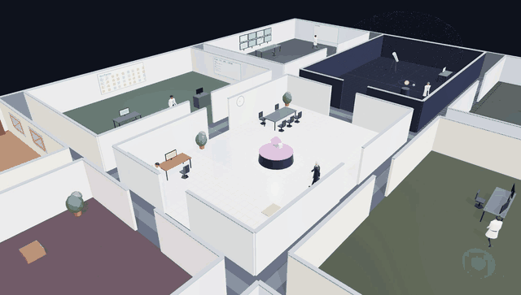
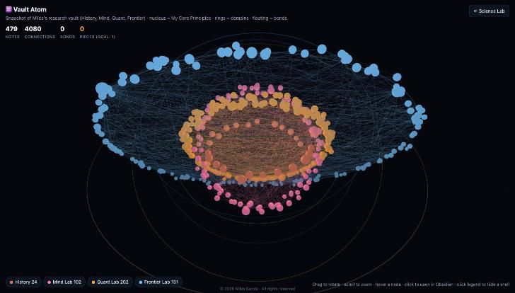

# Forge Labs Showcase

**▶ [Open the live demo](https://milesgurule-png.github.io/forge-showcase/lab/)**

**Live demos of projects by [Miles Gurule](https://github.com/milesgurule-png).** All demos use sample data.

| Demo | What it is |
|---|---|
| 🧪 **Science Lab** (`/lab`) | My AI agent team as scientists in a 3D research facility with 9 themed rooms. They walk to their rooms when an agent is working, hold conversations about their real research, and take coffee breaks. |
| ⚛️ **Vault Atom** (`/atom.html`) | About 500 research notes (history, psychology, math, physics) drawn as one connected atom with 4,000+ cited links. |

Built with Three.js, vanilla JavaScript and custom A* pathfinding. The production versions run locally and connect to my private AI agents.

---
**© 2026 Miles Gurule. All rights reserved.** This repository is **not open source**. See [LICENSE](LICENSE). Viewing the demos is fine. Copying or reusing the code is not permitted without written permission.
